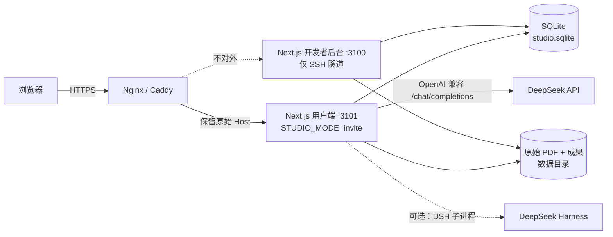

<p align="center">
  
</p>

<h1 align="center">sky learning · 学习工作台</h1>

<p align="center">
  把一份教材，变成<strong>可教、可练、可测</strong>的复习资料。
</p>

<p align="center">
  上传 PDF 或粘贴笔记 → 生成带页码出处的讲义、闪卡与自测 → 排复习路线 → 导出 PDF / 课件 / 视频。
</p>

<p align="center">
  
  
  
  
  
  
</p>

<p align="center">
  <a href="#-它解决什么问题">简介</a> ·
  <a href="#-功能一览">功能</a> ·
  <a href="#-快速开始">快速开始</a> ·
  <a href="#-配置">配置</a> ·
  <a href="#-部署到服务器">部署</a> ·
  <a href="#-常见问题">FAQ</a>
</p>

---


<p align="center"><sub>左栏资料 · 中间问答 · 右栏创作（学习资料、课件、视频、知识图谱、学习路径）与成果版本</sub></p>

## 💡 它解决什么问题

复习资料的难点不在「生成一段文字」，而在**每个结论都能回到教材某一行**。

sky learning 把这件事做成流水线：资料以 PDF 为唯一事实来源，生成时强制逐字引用 + 页码；成果按版本留存，可以导出、拿去做课件和视频，也可以按知识点掌握度继续往下学。

- **有出处**：讲义、闪卡、自测题都带 `原文引用 + 页码`，点一下跳回原 PDF 对应页。
- **有节奏**：复习路线按讲义、自测目标、优先知识点与可用时间排；学过的会记住，下次自动跳过。
- **有产出**：Markdown、PDF、原生 PPTX、MP4，都能直接拿去用。
- **不绑云**：PDF 原文留在你自己的机器或服务器上，只有检索到的文本片段会发往模型。

## 🧩 功能一览

| 能力 | 说明 |
| --- | --- |
| 📚 **学习资料生成** | 四种方案：材料学习教练、期末自学、系统复习资料包（推荐）、复习资料工作台（全能融合版） |
| 🔍 **带出处的讲义** | 学习路线、讲义正文、闪卡、自测题全部标注页码，可回跳原文 |
| 🖼 **扫描页视觉读取** | 无文字层的页面渲染成图片交给官方 DeepSeek Flash 读图，引用会标注「视觉读取」（需默认接口地址，见下文） |
| 💬 **问答** | 在当前勾选的资料里检索后作答，空笔记本也可以直接追问 |
| 📄 **PDF 导入** | 单份最大 500 MB / 700 页；大文件走 8 MiB 分片并行上传，失败自动重试，正文按需提取 |
| 🧾 **导出** | Markdown / 排版好的 PDF（内置中文字体、页码页脚） |
| 🖥 **课件** | 审核逐页提纲 → 编辑屏显与演讲者备注 → 下载原生 PPTX，文字、线条、备注都能再编辑 |
| 🎬 **视频** | 分镜编辑 + 旁白配音，Remotion 渲染；改动单个分镜只重渲染该段 |
| 🗺 **知识图谱** | 全账号知识点关系图（d3-force），可看 1–3 层邻居、拖拽、点击跳到讲义 |
| 📈 **学习路径与掌握度** | 计时、标记已复习 / 已掌握，后续路线自动跳过已掌握的知识点 |
| 🎟 **邀请内测** | 公开邀请码或一次性邀请链接，QQ 号登记即用，无密码 |
| 🛠 **开发者后台** | 配置全平台模型接口、查看账号与上传原文（仅本机模式 + 密码解锁，不对公网暴露） |

## 🏗 架构



两个 Next.js 进程**共用同一份数据目录**：用户端负责读写业务数据，开发者后台只负责配置。开发者后台永远只监听回环地址，通过 SSH 隧道访问。

## 🚀 快速开始

**环境要求**：Node.js ≥ 24、npm。

```powershell
npm ci
if (!(Test-Path .env.local)) { Copy-Item .env.example .env.local }
npm run probe      # 探测模型与运行环境
npm run dev        # http://127.0.0.1:3100
```

打开 <http://127.0.0.1:3100>，点首页的 **语法示例 / Grammar demo**：示例自带一份学习资料，可以先体验原文引用、PDF 导出和学习路线。发起问答或生成新资料前，按下文配置接口。

生产模式：

```powershell
npm run build
npm start          # http://127.0.0.1:3100
```

本地文件都在 `.local/`（SQLite、原始 PDF、DSH 运行目录）。备份时先停服务，再整个目录复制。

## 🔄 一份教材的完整流程

1. **添加资料**：新建笔记本 → 上传 PDF（分片上传，上传完立刻可看原件）或粘贴笔记 → 勾选要用的来源。
2. **生成成果**：Studio → **学习资料** → 选方案与范围（默认整份可读正文，也可指定页码 / 段落）。长材料自动分批，失败可从已完成批次继续。
3. **核对与回看**：讲义里的每条引用点回原文；成果按版本保存，可下载 PDF / Markdown。
4. **做课件与视频**（可选）：生成逐页提纲 → 编辑 → 导出 PPTX；或生成分镜 + 旁白 → 渲染 MP4。
5. **安排复习**：选成果、目标与可用时间生成学习路径，按节点打卡，掌握度会回写到图谱。

## ⚙️ 配置

首次使用官方 DeepSeek 接口，在 `.env.local` 里填写：

```dotenv
DEEPSEEK_API_KEY=填入服务端使用的密钥
DEEPSEEK_MODEL=deepseek-flash
```

| 变量 | 必填 | 说明 |
| --- | :---: | --- |
| `DEEPSEEK_API_KEY` | ✅ | 模型密钥；后台保存全平台配置后以此为准 |
| `DEEPSEEK_MODEL` | ✅ | 模型 ID，默认 `deepseek-flash` |
| `STUDIO_DATA_DIR` | 部署必填 | 持久化目录绝对路径（SQLite + PDF），两个进程必须一致 |
| `STUDIO_PUBLIC_ORIGIN` | 对外必填 | 公网域名，用于同源校验与 Secure Cookie，如 `https://learn.example.com` |
| `STUDIO_MODE` | | `local`（默认，本机）/ `invite`（邀请内测） |
| `STUDIO_DEVELOPER_MODE` | | 设为 `1` 开启开发者后台 |
| `STUDIO_FEEDBACK_EMAIL` | | 反馈窗口展示的联系邮箱 |
| `DSH_ENTRY` | | DeepSeek Harness 的 `lib/bin.js` 绝对路径（非默认安装位置时需要） |
| `STUDIO_PDF_FONT` | | 导出 PDF 的中文字体绝对路径（缺省自动找 Noto / 微软雅黑） |
| `STUDIO_PDF_FONT_FACE` | | TTC 字体集合内的字体名，如 `NotoSansCJKsc-Regular` |
| `STUDIO_BROWSER` / `FFMPEG_PATH` / `FFPROBE_PATH` | | 渲染视频时指定 Edge 与 FFmpeg 位置 |

**Chat** 由服务端直接调用模型接口。**生成学习资料**走哪条路取决于接口地址：

- `https://api.deepseek.com`（默认）→ 内置 DeepSeek Harness（DSH）子进程，能力最全，但需要 DSH 可用（`DSH_ENTRY`）。
- `https://api.deepseek.com/v1` 或任意 OpenAI 兼容地址 → 直接走 `/chat/completions`，更轻量，但**扫描页视觉读取会关闭**。

## ☁️ 部署到服务器

完整步骤见 [DEPLOY.md](DEPLOY.md)，以 Ubuntu 24.04 + Nginx + systemd 为例：

```bash
# 1) 依赖、字体与构建
npm ci
cp .env.example .env.local        # 填 STUDIO_PUBLIC_ORIGIN / STUDIO_DATA_DIR / 模型密钥
sudo apt-get install -y --no-install-recommends fonts-noto-cjk   # 导出中文 PDF 需要
npm run build

# 2) 开发者密码（云端设置一次）
npm run developer:password

# 3) 两个长期进程（建议交给 systemd）
STUDIO_MODE=invite STUDIO_DEVELOPER_MODE=0 \
  node node_modules/next/dist/bin/next start --hostname 127.0.0.1 --port 3101
STUDIO_MODE=local  STUDIO_DEVELOPER_MODE=1 \
  node node_modules/next/dist/bin/next start --hostname 127.0.0.1 --port 3100
```

反向代理只暴露 3101，三件事必须做对：

```nginx
location / {
    proxy_pass http://127.0.0.1:3101;
    proxy_set_header Host $host;              # 必须保留原始 Host，应用用它校验同源
    proxy_set_header X-Forwarded-Proto https;
    client_max_body_size 500m;                # PDF 上限
    proxy_request_buffering off;              # 分片 PUT 直通，不要缓冲
    proxy_read_timeout 600s;                  # 生成任务耗时较长
}
```

- 🔒 开发者后台 3100 **不要**映射到公网，用 `ssh -N -T -L 13100:127.0.0.1:3100 user@host` 后访问 `http://127.0.0.1:13100/developer`。
- 🧩 升级时保留数据目录与 `.env.local`，重新 `npm run build` 后重启两个进程即可；回滚就是把旧目录换回去。
- 🌏 内存小的机器（≤ 2 GiB）构建必须限内存，例如 `NODE_OPTIONS=--max-old-space-size=1100 npm run build`，并准备好 swap。
- 🩺 部署后可用 `GET /api/status` 自检：返回 `{"key":true,"dsh":true,"kit":true,"pdfVision":false}`，`pdfVision` 即扫描页读取是否可用。

## 🔐 开发者后台

1. `STUDIO_DEVELOPER_MODE=1` 启动（通常是 3100 那个进程）。
2. 运行 `npm run developer:password`，设置 10–128 字符的开发者密码。
3. 打开 `/developer`，解锁有效期 30 分钟。
4. 解锁后可填写接口地址、模型 ID、API Key，测试连接并保存；也可查看账号、登录会话与各账号上传的原文。

后台保存的模型配置**全平台共用**；只有从未保存过，才回落到环境变量里的 `DEEPSEEK_API_KEY` / `DEEPSEEK_MODEL`。密钥只留在服务端 SQLite，不写入前端。

## 🎟 邀请内测

```bash
# .env.local 里设置 STUDIO_MODE=invite
npm run invite -- --link     # 7 天有效的一次性邀请链接
npm run invite -- --public   # 30 天有效的公开内测码
npm run feedback             # 查看反馈
```

邀请码按 QQ 号首次登记验证；登记过的用户在任何设备输入 QQ 号即可登录，无需密码。切回 `local` 模式即可看到原有本地笔记本。

> 部署前想清楚：知道 QQ 号的人都能登录对应账号，适合可信的小范围内测。

## 🧠 四种生成方案

| 方案（技能 ID） | 适合什么时候用 | 主要成果 |
| --- | --- | --- |
| **材料学习教练**（`standard`） | 手上有一份材料，想知道怎么学、怎么检查理解 | 学习路线、带引用的讲义与自测 |
| **期末自学**（`examlearning`） | 需要梳理章节结构并按难度练习 | 知识地图、闭卷复习路线、分层自测 |
| **系统复习资料包**（`review-learning-kit`，推荐） | 想用一套资料从理解复习到主动回忆 | 复习大纲、讲义、知识关联、闪卡与日常自测 |
| **复习资料工作台**（`study-review-workbench`，全能融合版） | 有明确任务，如整章自学、结合考纲练习、诊断错题 | 以讲义和闪卡为主，按「学习重点」调整 |

方案通过项目内的 [生成模板](./dsh) 实现，部署时随项目一起提供。可下载的成果格式为 PDF 和 Markdown。

## 📁 目录结构

```text
learning-studio/
├─ app/                     # 页面与 UI（studio、study-view、knowledge-graph、pdf-upload…）
│  └─ api/[[...segments]]/  # 全部 HTTP 接口（单一 catch-all 路由）
├─ lib/                     # 业务逻辑：store / jobs / sources / study / deepseek / dsh …
├─ dsh/                     # 生成学习资料时给 DSH 的提示词模板
├─ scripts/                 # probe / invite / feedback / developer-password
├─ video/                   # Remotion 视频渲染
├─ public/                  # 静态资源与 Logo
├─ docs/                    # README 截图
├─ tests/                   # node --test 测试
├─ .env.example
├─ DEPLOY.md                # 云服务器部署说明
└─ README.md
```

数据层用 `node:sqlite`（`DatabaseSync`），没有外部数据库依赖。PDF 读取用 `pdfjs-dist`（扫描页渲染用 `@napi-rs/canvas`），导出用 `pdfkit` + `pptxgenjs`，视频用 `remotion`。

## 🧪 常用命令

| 命令 | 作用 |
| --- | --- |
| `npm run dev` | 开发模式，127.0.0.1:3100 |
| `npm run build` / `npm start` | 生产构建与启动 |
| `npm run check` | TypeScript 类型检查 |
| `npm test` | 运行 `tests/*.test.ts` |
| `npm run probe` | 探测模型、DSH 与运行环境是否可用 |
| `npm run invite` | 生成邀请码 / 邀请链接 |
| `npm run developer:password` | 重设开发者密码（旧会话立即失效） |
| `npm run feedback` | 查看反馈 |

## 📏 使用限制

- 单份 PDF 最大 **500 MB / 700 页**，分片大小固定 **8 MiB**。
- 有文字层的页面直接抽取；无文字层的页面在**默认接口 + `deepseek-flash`** 时按页渲染成图片交给模型读图，其余情况需要先 OCR 或粘贴原文。
- 问答按当前勾选来源检索，每次最多 **12 个片段**。
- 单次学习资料的「材料范围」上限约 **55,000 字符**，整本教材建议分章节生成。
- 生成任务在本机**串行**执行；服务重启后队列会继续，中断的任务在租约到期后标记失败并可重试。
- 视频渲染依赖 Windows 语音与 Edge（`FFMPEG_PATH` / `FFPROBE_PATH` 可指定路径），其它平台需给 Remotion 另配 TTS。

## 🩺 常见问题

<details>
<summary><b>生成资料时报 <code>dsh: startup failed</code> 或 <code>$.mode expected nullable</code></b></summary>

内置 DSH 新版已移除 `tools.mode`，而应用会固定传入 `{ mode: "native" }`。临时方案：在开发者后台把接口地址写成 `https://api.deepseek.com/v1`，走直连的 OpenAI 兼容路径（代价是扫描页视觉读取关闭）。
</details>

<details>
<summary><b>扫描件提示「所选页码没有可读正文」，没有走视觉读取</b></summary>

视觉读取只在接口地址为默认 `https://api.deepseek.com` 且模型为 `deepseek-flash` 时开启（对应 `/api/status` 的 `pdfVision`）。如果地址被写成 `.../v1` 绕开 DSH，请改回默认地址再试，或直接把原文粘贴成文字来源。
</details>

<details>
<summary><b>导出 PDF 返回 503 或中文变方框</b></summary>

缺中文字体。Debian/Ubuntu：`apt-get install fonts-noto-cjk`；其他系统用 `STUDIO_PDF_FONT` 指向任意中文字体文件，TTC 集合再配 `STUDIO_PDF_FONT_FACE`。
</details>

<details>
<summary><b>分片上传报 <code>上传分片不完整</code></b></summary>

除最后一片外每片必须正好 8 MiB。检查反向代理 / CDN 是否放行 `PUT`、`client_max_body_size` 是否 ≥ 500m、是否启用了 `proxy_request_buffering off`。
</details>

<details>
<summary><b>Windows 上 DSH 初始化报 <code>EPERM</code></b></summary>

在项目目录的普通 PowerShell 里初始化一次：

```powershell
$env:DSH_HOME = Join-Path (Get-Location) '.local/dsh'
dsh --profile headless --help
npm run probe
```
</details>

<details>
<summary><b>外网访问返回 403 / 一直「读取工作台」</b></summary>

两种常见原因：反向代理把 `Host` 改成了 `127.0.0.1:port`（必须 `proxy_set_header Host $host`）；或 `STUDIO_PUBLIC_ORIGIN` 与实际访问域名不一致，同源校验不通过。
</details>

## 🔒 数据与隐私

- 原始 PDF、SQLite、生成成果都保存在你的数据目录，不上传第三方存储。
- 只有问答与生成时**检索到的文本片段**、以及开启视觉读取时**渲染出的页面图片**会发送给所配置的模型接口。
- 模型密钥保存在服务端 SQLite，不写入前端。

---

<p align="center">
  <sub>sky learning · 让每一行结论都能回到教材那一页</sub>
</p>
